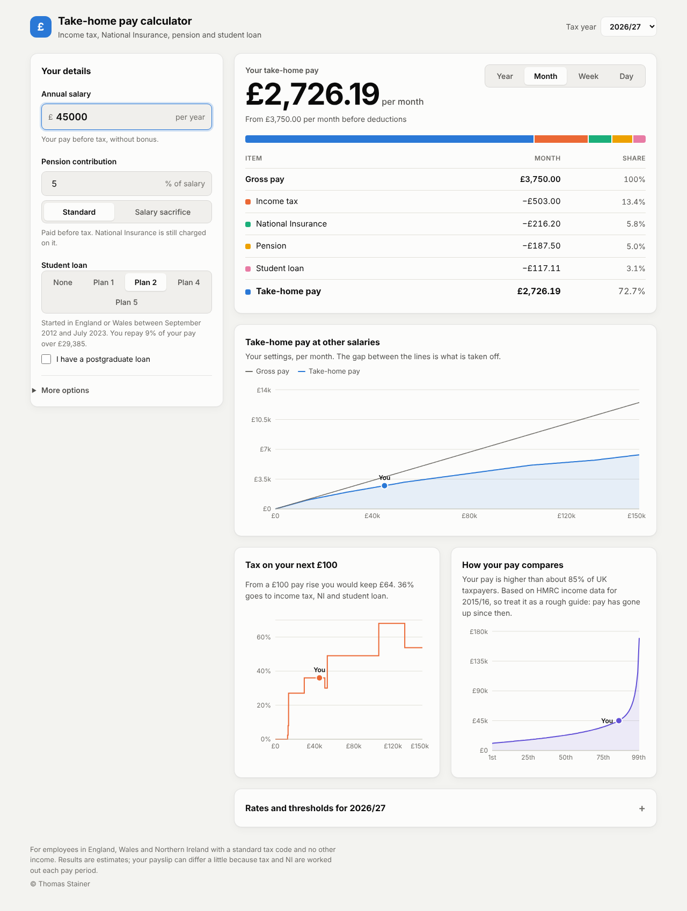

# Money

### UK take-home pay calculator

Enter your salary and see your income tax, National Insurance, pension, student loan
and take-home pay per year, month, week or day.



## Features

- Tax years 2020/21 to 2026/27 (England, Wales and Northern Ireland).
- Pension contributions as standard (net pay) or salary sacrifice.
- Student loan Plan 1, 2, 4 and 5, plus postgraduate loans.
- Bonus or overtime with no pension contribution, and other salary sacrifice
  (for example childcare vouchers).
- Charts: take-home pay at other salaries, tax on your next £100, and how your pay
  compares with other UK taxpayers.
- Your inputs are kept in the address bar, so you can bookmark or share a result.
- Light and dark themes.

## Development

Requires Node.js 20 or later.

```bash
npm install
npm run dev      # start the dev server
npm test         # run the unit tests
npm run build    # build for production into dist/
```

To build and serve with Docker:

```bash
docker build -t money .
docker run -p 8080:80 money
```

## Updating rates

All rates and thresholds are in [`src/tax/years.ts`](src/tax/years.ts). To add a new tax
year, add an entry at the top of `TAX_YEARS`. The income comparison data is in
[`src/data/percentiles.ts`](src/data/percentiles.ts).

Built with React, TypeScript, Vite and Recharts.
